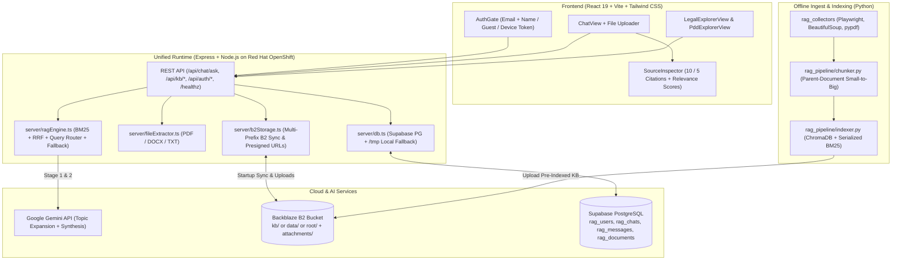
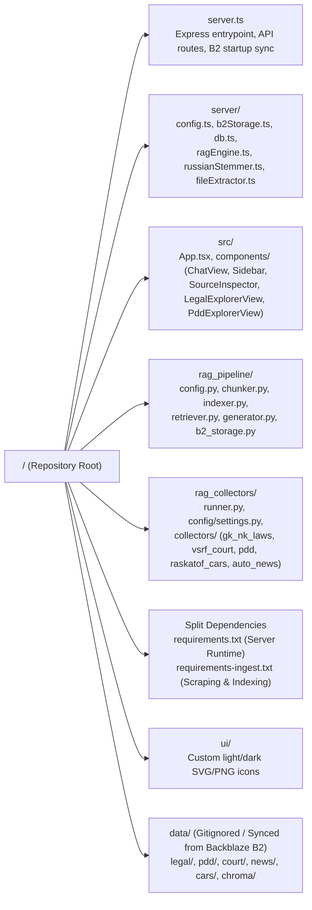
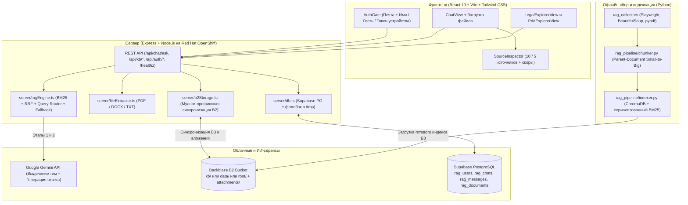
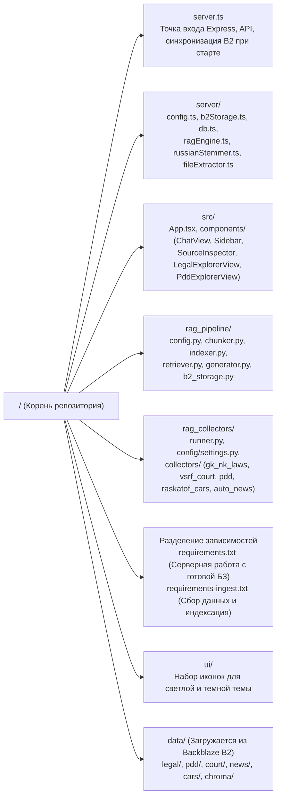

<div align="center">

# Legal RAG Assistant & Regulatory Explorer

**Hybrid Legal AI Assistant & Knowledge Base Explorer for Automotive Leasing, Civil/Tax/Traffic Law, and Supreme Court Case Law**

[English](#english) · [Русский](#russian)

[](#english)
[](#english)
[](#english)
[](#english)
[-E21E29?style=flat-square)](#english)
[](#english)

</div>

---

<a id="english"></a>

> Language: **English** | [Переключить на русский](#russian)

## Overview

**Legal RAG Assistant** is a full-stack production web application and data ingestion pipeline built for automotive rental-with-buyout (*leasing / "raskat"*) legal teams in the Russian Federation.

It combines:
1. **A two-stage Hybrid RAG engine** powered by Google Gemini API, morphological Russian BM25 (`pymorphy3` / Russian Snowball stemmer), optional ChromaDB dense vectors (`BAAI/bge-m3`), and two-stage Cross-Encoder reranking (`BAAI/bge-reranker-v2-m3`).
2. **A React 19 + Tailwind CSS SPA** served alongside an **Express (Node.js) API** as a unified service—featuring asynchronous job execution, a side-by-side **Source Inspector**, document attachment parsing (`PDF`, `DOCX`, `TXT`), light/dark themes, and built-in **Regulatory Code** and **Traffic Rules (PDD)** explorers.
3. **Stateless Cloud Persistence** designed for **Red Hat OpenShift** arbitrary non-root containers using **Supabase (PostgreSQL)** for user profiles/chat history and **Backblaze B2 (S3-compatible)** for knowledge base hydration and user attachments.

---

## System Architecture



### Two-Stage Retrieval Strategy
- **Gemini Available (10 Sources):** `QueryRouter` selects target domain collections -> Stage 1 retrieves **5 baseline sources** -> Gemini extracts **2–6 legal search sub-topics** -> Stage 2 gathers up to **~40 candidates**, reranks them, and selects **5 complementary sources** -> **10 primary sources** total.
- **Gemini Unavailable Fallback (5 Sources):** Automatically caps retrieval at **5 baseline sources** and generates a structured deterministic extractive summary without failing the user request.

---

## Project Structure



---

## Key Features

- **Hybrid Search & Reranking:** Combines morphological BM25 (lemmatization via `pymorphy3` / Snowball stemmer), ChromaDB dense vector search (`BAAI/bge-m3`), Reciprocal Rank Fusion (RRF), Metadata Priority Boosting, and a two-stage Heuristic -> Cross-Encoder reranker (`BAAI/bge-reranker-v2-m3`).
- **Parent-Document (Small-to-Big) Chunking:** Indexes ~20,000 statutory articles (Civil Code, Tax Code, Administrative Code, Leasing/OSAGO laws), PDD chapters, and Supreme Court rulings as focused semantic chunks while preserving complete parent articles for viewing.
- **Interactive Regulatory & PDD Explorers:**
  - Filter codes by statute (`ГК РФ`, `НК РФ`, `КоАП РФ`, federal laws) with dynamic dependent topic categories.
  - Browse structured Traffic Rules (PDD RF) chapters with instant keyword highlighting and direct deep-linking (`?doc=...`, `?pdd=...`).
- **Asynchronous RAG Chat & Document Analysis:** Non-blocking job polling, `PDF`/`DOCX`/`TXT` attachment parsing (with Cyrillic filename normalization and Backblaze B2 presigned links), persistent chat threads (pin/rename/delete), and device auto-login plus Guest mode.
- **OpenShift-Ready Architecture:**
  - Respects OpenShift arbitrary non-root UIDs by probing `./data`, `./data/chats`, and `./logs` and transparently falling back to `/tmp/legal-rag-*` when container directories are read-only.
  - Resilient Backblaze B2 sync supporting multiple bucket folder layouts (`kb/`, `data/`, or bucket root subdirectories) and AWS SDK v3 checksum compatibility.

---

## Python Dependencies Split

Dependencies are intentionally separated so production inference containers stay lean while offline scrapers/indexers remain self-contained:

| File | Purpose | Includes |
|---|---|---|
| `requirements.txt` | **Server Runtime** (serving pre-indexed KB files) | `google-genai`, `pymorphy3`, `chromadb`, `sentence-transformers`, `pypdf`, `python-docx`, `psycopg2-binary`, `boto3` |
| `requirements-ingest.txt` | **Data Collection & Indexing** (offline/worker pipeline) | `-r rag_collectors/requirements.txt` + `pandas`, `chromadb`, `sentence-transformers`, `pymorphy3`, `boto3`, `pyyaml` |
| `rag_collectors/requirements.txt` | **Standalone Scrapers** | `playwright`, `requests`, `beautifulsoup4`, `pypdf`, `pyyaml`, `lxml` |

---

## Deployment on Red Hat OpenShift

### 1. Environment Variables

Configure these variables in your OpenShift `Deployment` / `Secret` / `ConfigMap` (see `.env.example`):

```bash
# Runtime
PORT=8080
NODE_ENV=production
# Optional explicit writable directory (auto-falls back to /tmp/legal-rag-data if omitted/read-only)
RAG_DATA_DIR=/tmp/legal-rag-data

# Google Gemini API
GEMINI_API_KEY=your_gemini_api_key
LLM_MODEL_NAME=gemini-4-hydrogen

# Supabase / PostgreSQL
HOST=aws-1-eu-north-1.pooler.supabase.com
DB_PORT=6543
SUPABASE_USER=postgres.your_project_ref
PASSWORD=your_db_password
DB_NAME=postgres

# Backblaze B2 Storage (S3-Compatible)
B2_ENDPOINT=https://s3.eu-central-003.backblazeb2.com
B2_KEY_ID=your_b2_key_id
B2_APPLICATION_KEY=your_b2_application_key
B2_REGION=eu-central-003
# Required if your B2 key is scoped to a single bucket (ListBuckets fails on restricted keys)
B2_BUCKET_NAME=your-bucket-name
# Optional: force KB re-sync on every pod startup
B2_AUTO_SYNC=false
```

### 2. Backblaze B2 Knowledge Base Sync Checklist (OpenShift)

If the app starts on OpenShift and Gemini responds, **but the knowledge base count shows `0`**:
1. **Set `B2_BUCKET_NAME` explicitly:** Bucket-restricted Backblaze B2 Application Keys cannot call `ListBuckets`. Always provide `B2_BUCKET_NAME` (aliases `B2_BUCKET`, `BACKBLAZE_BUCKET_NAME` are also supported).
2. **Writable storage on non-root OpenShift pods:** OpenShift runs containers with a random UID. The server automatically falls back to `/tmp/legal-rag-data` if `./data` is not writable (or mount an `emptyDir` / PVC at `/tmp/legal-rag-data` or set `RAG_DATA_DIR`).
3. **Bucket key layout:** `syncKbFromB2` automatically scans `kb/` first, then `data/`, then bucket root (`legal/`, `pdd/`, `court/`, `news/`, `cars/`, `chroma/`).
4. **Verify live diagnostics:** Inspect `GET /healthz` or `GET /api/health` to view `b2Sync` (`bucket`, `dataDir`, `prefixUsed`, `found`, `downloaded`, `errors`, `lastError`) and trigger a manual re-sync anytime via `POST /api/kb/sync`.

### 3. Build & Start Commands

```bash
npm ci
npm run build
npm run start
```

Health probes for OpenShift `readinessProbe` / `livenessProbe`:
- `GET /healthz` (HTTP 200 JSON)
- `GET /api/health` (HTTP 200 JSON)

---

## Local Development & KB Preparation

### Run the Web Application (Node.js + React)

```bash
npm install
cp .env.example .env
# Populate GEMINI_API_KEY, Supabase, and B2 variables in .env
npm run dev
```

Open `http://localhost:3000`.

### Collect Data, Build Indices, and Upload to Backblaze B2

```bash
# 1. Install ingest & indexing dependencies
pip install -r requirements-ingest.txt
playwright install chromium

# 2. Check collector status or run data collection
python rag_collectors/runner.py --status
python rag_collectors/runner.py --collector all

# 3. Build hierarchical ParentStore, ChromaDB vectors, and serialized BM25 indices
python reindex_rag.py

# 4. Upload pre-indexed KB (data/{legal,pdd,court,news,cars,chroma}) to Backblaze B2
npm run b2:upload
# Or via Python:
python -m rag_pipeline.b2_storage --upload-kb
```

---

---

<a id="russian"></a>

> Язык: [Switch to English](#english) | **Русский**

## О проекте

**Legal RAG Assistant** — это full-stack веб-приложение и модульный конвейер сбора и индексации данных для юридических отделов компаний, занимающихся арендой автомобилей с последующим выкупом (*раскат / лизинг*) в Российской Федерации.

Система объединяет:
1. **Двухэтапный гибридный RAG-движок** на базе Google Gemini API, морфологического поиска BM25 (`pymorphy3` / стеммер Портера), векторного поиска ChromaDB (`BAAI/bge-m3`) и двухэтапного реранкинга с Cross-Encoder (`BAAI/bge-reranker-v2-m3`).
2. **Единый сервис Express (Node.js) + React 19 (Tailwind CSS)** с асинхронной обработкой запросов, правой панелью-инспектором первоисточников, разбором прикрепленных документов (`PDF`, `DOCX`, `TXT`), светлой/темной темой и встроенными справочниками **Нормативно-правовой базы** и **ПДД РФ**.
3. **Cloud-Native хранение без локального диска** для запуска на **Red Hat OpenShift**: профили пользователей и чаты хранятся в **Supabase (PostgreSQL)**, а база знаний и вложения пользователей синхронизируются из **Backblaze B2 (S3-совместимое хранилище)**.

---

## Архитектура системы



### Двухэтапный сценарий поиска (10 / 5 первоисточников)
- **Gemini API доступен (10 источников):** `QueryRouter` определяет целевые коллекции -> Этап 1 отбирает **5 базовых фрагментов** -> Gemini формулирует **2–6 поисковых подтем** -> Этап 2 собирает до **~40 кандидатов**, переранжирует их и добавляет **5 тематических источников** -> Итого **10 первоисточников**.
- **Резервный сценарий при сбое Gemini API (5 источников):** поиск ограничивается **5 базовыми фрагментами**, после чего формируется структурированный локальный ответ по найденным нормам.

---

## Структура проекта



---

## Ключевые возможности

- **Гибридный поиск и реранкинг:** объединяет морфологический лексический поиск BM25 (`pymorphy3` / стеммер Портера), плотные эмбеддинги ChromaDB (`BAAI/bge-m3`), Reciprocal Rank Fusion (RRF), приоритетный буст отраслевых норм и двухэтапный реранкинг (эвристика -> `BAAI/bge-reranker-v2-m3`).
- **Иерархический чанкинг (Parent-Document / Small-to-Big):** разбивает ~20 000 статей кодексов (ГК РФ, НК РФ, КоАП РФ, законы о лизинге и ОСАГО), главы ПДД и акты ВС РФ на точные поисковые фрагменты, сохраняя полные тексты статей для просмотра.
- **Справочники НПА и ПДД РФ:**
  - Зависимая фильтрация категорий по выбранному кодексу/закону (`ГК РФ`, `НК РФ` и др.).
  - Интерактивный просмотр глав ПДД с подсветкой ключевых слов и прямыми ссылками из ответов ассистента (`?doc=...`, `?pdd=...`).
- **Асинхронный RAG-чат и работа с документами:** фоновые задачи без блокировки интерфейса, извлечение текста из `PDF`, `DOCX` и `TXT` (с поддержкой кириллических имен файлов и временными ссылками Backblaze B2), закрепление/переименование/удаление чатов, автовход по токену устройства и гостевой режим.
- **Готовность к Red Hat OpenShift:**
  - Поддержка произвольного non-root UID в OpenShift: проверка прав записи для `./data`, `./data/chats` и `./logs` с автоматическим переключением на `/tmp/legal-rag-*`.
  - Устойчивая синхронизация Backblaze B2 с поддержкой структур бакета `kb/`, `data/` и корневых директорий, а также совместимостью с ограниченными ключами бакета.

---

## Разделение Python-зависимостей

Зависимости разделены на два контура, чтобы серверный контейнер не тянул браузерные и скрапинговые пакеты:

| Файл | Назначение | Состав |
|---|---|---|
| `requirements.txt` | **Серверный запуск** (работа с уже готовой индексированной БЗ) | `google-genai`, `pymorphy3`, `chromadb`, `sentence-transformers`, `pypdf`, `python-docx`, `psycopg2-binary`, `boto3` |
| `requirements-ingest.txt` | **Модуль сбора данных и индексации** (офлайн / воркер) | `-r rag_collectors/requirements.txt` + `pandas`, `chromadb`, `sentence-transformers`, `pymorphy3`, `boto3`, `pyyaml` |
| `rag_collectors/requirements.txt` | **Изолированные коллекторы** | `playwright`, `requests`, `beautifulsoup4`, `pypdf`, `pyyaml`, `lxml` |

---

## Деплой на Red Hat OpenShift

### 1. Переменные окружения

Настройте переменные в OpenShift `Deployment` / `Secret` / `ConfigMap` (шаблон — в `.env.example`):

```bash
# Параметры сервера
PORT=8080
NODE_ENV=production
# Опционально: явный каталог с правами записи (иначе используется авто-фоллбэк в /tmp/legal-rag-data)
RAG_DATA_DIR=/tmp/legal-rag-data

# Google Gemini API
GEMINI_API_KEY=your_gemini_api_key
LLM_MODEL_NAME=gemini-4-hydrogen

# Supabase / PostgreSQL
HOST=aws-1-eu-north-1.pooler.supabase.com
DB_PORT=6543
SUPABASE_USER=postgres.your_project_ref
PASSWORD=your_db_password
DB_NAME=postgres

# Backblaze B2 Storage (S3-совместимый API)
B2_ENDPOINT=https://s3.eu-central-003.backblazeb2.com
B2_KEY_ID=your_b2_key_id
B2_APPLICATION_KEY=your_b2_application_key
B2_REGION=eu-central-003
# Обязательно укажите имя бакета, если ключ B2 ограничен одним бакетом (ListBuckets запрещен)
B2_BUCKET_NAME=your-bucket-name
# Опционально: принудительная синхронизация БЗ при каждом старте пода
B2_AUTO_SYNC=false
```

### 2. Диагностика загрузки базы знаний из Backblaze B2 в OpenShift

Если приложение запустилось на OpenShift и ИИ отвечает по API, но **база знаний не подгрузилась (`0 статей`)**:
1. **Задайте `B2_BUCKET_NAME` явно:** при использовании Application Key с доступом к одному бакету метод `ListBuckets` возвращает ошибку доступа. Укажите `B2_BUCKET_NAME` (также поддерживаются `B2_BUCKET` и `BACKBLAZE_BUCKET_NAME`).
2. **Права записи в OpenShift (arbitrary non-root UID):** если каталог `./data` в образе контейнера доступен только на чтение, сервер автоматически переключается на `/tmp/legal-rag-data` (либо смонтируйте `emptyDir`/PVC и укажите `RAG_DATA_DIR`).
3. **Префиксы в бакете B2:** синхронизация последовательно проверяет префиксы `kb/`, `data/` и корень бакета (`legal/`, `pdd/`, `court/`, `news/`, `cars/`, `chroma/`).
4. **Проверка состояния:** откройте `GET /healthz` или `GET /api/health` для просмотра поля `b2Sync` (`bucket`, `dataDir`, `prefixUsed`, `found`, `downloaded`, `errors`, `lastError`) или запустите повторную синхронизацию через `POST /api/kb/sync`.

### 3. Команды сборки и запуска

```bash
npm ci
npm run build
npm run start
```

Эндпоинты для OpenShift `readinessProbe` / `livenessProbe`:
- `GET /healthz`
- `GET /api/health`

---

## Локальный запуск и обновление базы знаний

### Запуск веб-приложения (Node.js + React)

```bash
npm install
cp .env.example .env
# Заполните GEMINI_API_KEY, Supabase и Backblaze B2 в .env
npm run dev
```

Интерфейс будет доступен на `http://localhost:3000`.

### Сбор данных, переиндексация и загрузка в Backblaze B2

```bash
# 1. Установка зависимостей для сбора и индексации
pip install -r requirements-ingest.txt
playwright install chromium

# 2. Проверка статуса и запуск коллекторов
python rag_collectors/runner.py --status
python rag_collectors/runner.py --collector all

# 3. Построение ParentStore, векторного индекса ChromaDB и сериализованного BM25
python reindex_rag.py

# 4. Загрузка готовой БЗ (data/{legal,pdd,court,news,cars,chroma}) в Backblaze B2
npm run b2:upload
# Или через Python:
python -m rag_pipeline.b2_storage --upload-kb
```
